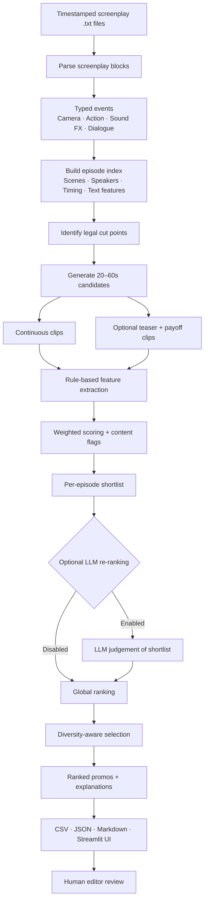

<div align="center">

# 🎬 Kuku Promo Extractor

### Find editor-ready promo moments from timestamped microdrama screenplays.

**A screenplay-first promo discovery pipeline that identifies 20–60 second clips, validates edit boundaries, scores narrative engagement, and ranks candidates for human review.**

<p>
  <a href="https://kukupromoextractor-cwkhzwvrapo58br5mq2dpq.streamlit.app/"><strong>🚀 Try the Live App</strong></a>
  &nbsp;·&nbsp;
  <a href="https://github.com/nischay1905/Kuku_Promo_Extractor"><strong>📂 View Source Code</strong></a>
</p>

</div>

---

## Overview

Finding short promotional moments in a long-running microdrama is a time-consuming editorial task. A strong promo needs more than an exciting line: it should capture attention quickly, build tension, end on an unresolved beat, and remain understandable to someone who has not watched the episode.

**Kuku Promo Extractor** automates the first-pass discovery process. It reads timestamped `.txt` screenplays, generates valid clip candidates, evaluates their narrative and structural qualities, and produces a ranked shortlist with exact episode numbers, timestamps, dialogue, and explanations.

The system is designed as an **editorial decision-support tool, not an automatic publishing system**. It narrows the search space so an editor can spend more time reviewing promising moments and less time manually scanning every episode. The generated export from the included run contains **49 promo candidates across 34 distinct episodes**, with both continuous and stitched formats.

> **Important:** The current implementation analyses screenplay text and script metadata. It does not inspect the actual video, audio, facial expressions, shot composition, or audience-retention data. A high score is a ranking signal, not a guarantee of performance.

## 🔗 Live Demo

| Resource | Link |
|---|---|
| Streamlit application | [Open Kuku Promo Extractor](https://kukupromoextractor-cwkhzwvrapo58br5mq2dpq.streamlit.app/) |
| Source code | [GitHub Repository](https://github.com/nischay1905/Kuku_Promo_Extractor) |

Upload one or more episode screenplay files, configure the scoring threshold and clip limits, and run the analysis. Results can be reviewed in the app or exported as CSV, JSON, and Markdown.

---

## What the system looks for

A candidate promo is evaluated against six complementary signals:

| Signal | What it measures | Default weight |
|---|---|---:|
| Opening hook | Whether the opening seconds contain an attention-grabbing line, stake, accusation, or action | 28% |
| Cliffhanger | Whether the clip ends on unresolved tension, a question, threat, or episode-ending beat | 28% |
| Emotional intensity | Delivery tags and textual indicators of emotional intensity | 14% |
| Pace | Dialogue and event density within the clip | 10% |
| Standalone clarity | Whether a new viewer can understand the stakes without extensive prior context | 12% |
| Duration fit | Preference for a usable promo length within the target range | 8% |

The weighted score is adjusted by configured penalties for flagged content and by an additional penalty for stitched candidates. The weights can be overridden through a JSON configuration in the CLI.

The scoring is intentionally **interpretable**: each selected clip carries feature-level scores and a short explanation instead of returning only an opaque model prediction.

---

## ⚙️ End-to-end workflow



### Pipeline stages

**1. Screenplay parsing**

The parser converts screenplay blocks into typed, timestamped events:

- `CAMERA`
- `ACTION`
- `SOUND FX`
- `DIALOGUE`

It extracts episode metadata, scene information, speaker labels, delivery tags, and start/end timestamps. Speaker labels are normalised with a lightweight title-removal step to reduce obvious naming variation.

**2. Episode indexing and feature extraction**

For each episode, the system builds an index of dialogue and events. It derives textual signals such as:

- Strong and medium hook words
- Accusation and high-stakes language
- Questions, exclamations, and unfinished sentences
- Emotional delivery tags
- Speaker continuity and dialogue density
- Context required to understand the scene

These signals support the later hook, cliffhanger, intensity, pace, and standalone estimates.

**3. Legal edit-boundary validation**

Candidate boundaries are constrained by screenplay timing and event structure. The pipeline uses camera-cut starts and legal event/line endings, and avoids cutting through spoken dialogue or split sentences.

This is a key design choice: **the scoring stage does not get to invent timestamps or arbitrary edit boundaries.** Structural constraints are applied before ranking.

**4. Candidate generation**

Two candidate types are supported:

- **Continuous:** one uninterrupted 20–60 second segment.
- **Stitched teaser + payoff:** a short opening teaser followed by a later payoff segment, with a minimum gap between the two segments.

Stitched candidates receive an additional score penalty so that they must justify their extra edit complexity. Cross-episode joins are not generated.

**5. Explainable scoring**

Each candidate receives a weighted score based on the six signals above. Content flags can apply penalties. The system also records component scores, detected hook and ending lines, and an explanation of why the candidate was selected.

**6. Per-episode filtering and global ranking**

Candidates are filtered using the configurable minimum score and per-episode limit. The global ranking then considers:

- Candidate quality
- Standalone clarity
- Episode position, to reduce premature spoilers
- Text similarity to already selected clips, to encourage variety

The global selector uses a greedy **Maximal Marginal Relevance (MMR)-style diversity penalty** and can limit selection to one clip per episode in the top posting shortlist. The exported top-10 list is a suggested editorial order, not a simple descending sort by the raw score.

**7. Optional LLM re-ranking**

An optional provider layer supports `anthropic`, `openai`, and `mock` providers. The LLM reviews only a small shortlist (approximately three candidates per episode), judging subjective qualities such as hook strength, unresolved ending, standalone clarity, and editorial usefulness.

The LLM can add a reason and optional caption, but **it does not generate or modify timestamps**. Candidate boundaries are established by the deterministic pipeline first.

The mock provider is used in tests. Live provider calls are implemented but have not been validated in the repository's reported evaluation because live API credentials were not available.

**8. Results and human review**

The application displays ranked clips with timestamps, duration, clip type, score, opening hook, ending beat, explanation, feature scores, flags, and transcript. Editors can inspect all candidates and export the results.

---

## 📊 Results from an actual project run

The following figures are taken from the generated `promos_all.json` and `promos_ranked_top.md` files included with this project run.

### Run summary

| Metric | Result |
|---|---:|
| Promo candidates generated | **49** |
| Distinct episodes represented in the output | **34** |
| Continuous clips | **44** |
| Stitched teaser + payoff clips | **5** |
| Clips with an editor flag | **6** |
| Candidates scoring ≥ 0.70 | **19 / 49** |
| Clip duration range | **20.7–59.8 seconds** |
| Average clip duration | **40.0 seconds** |
| Candidate score range | **0.6068–0.8120** |

The output contains 49 candidates across 34 distinct episode numbers. This does **not** mean that only 34 episodes were uploaded; it means those are the episodes represented among the generated candidates in this export.

### Top 10 editorial shortlist

The ranked Markdown report provides a suggested posting order. It is an editorial shortlist—not simply a descending sort of the raw candidate score. The selection is intended to balance clip quality, opening and ending strength, standalone clarity, episode coverage, and variety.

| Shortlist | Episode | Duration | Type | Score |
|---:|---:|---:|---|---:|
| 1 | 3 | 49.2 s | Continuous | 0.7239 |
| 2 | 29 | 30.2 s | Continuous | 0.7477 |
| 3 | 15 | 39.5 s | Continuous | 0.7745 |
| 4 | 28 | 25.5 s | Continuous | 0.7573 |
| 5 | 27 | 42.3 s | Stitched | 0.7433 |
| 6 | 20 | 44.2 s | Continuous | 0.7571 |
| 7 | 1 | 47.2 s | Continuous | 0.6538 |
| 8 | 2 | 33.5 s | Continuous | 0.6780 |
| 9 | 24 | 36.9 s | Continuous | **0.8120** |
| 10 | 13 | 40.9 s | Continuous | 0.7277 |

### Example candidate

**Episode 27 · 00:48.80–00:55.60 + 01:55.00–02:30.50**

- **Duration:** 42.3 seconds
- **Type:** Stitched teaser + payoff
- **Candidate score:** 0.7433
- **Opening hook:** A set of heavy doors bursts open, revealing the Blond Nobleman with Lady Catherine and a royal guard.
- **Ending beat:** The Blond Nobleman says, “Take her.”
- **Why it was selected:** The opening creates an immediate visual question, while the later payoff ends on a short, decisive line.

This example demonstrates why the system supports both uninterrupted clips and carefully joined teaser/payoff moments.

### What the results tell us

- The pipeline can produce a sizeable, timestamped shortlist rather than asking an editor to scan every screenplay manually.
- Most candidates in this run are continuous clips; stitched clips are available as an additional editing option.
- Feature-level scores and explanations make it possible to inspect *why* a candidate was selected.
- Editor flags and context notes expose cases that still need human judgement. In this export, six candidates carry a `violence/torture` flag.
- The highest raw score is not automatically the first suggested posting choice. The shortlist order serves a different purpose from sorting candidates by one score alone.

> **Evaluation note:** These are output-generation results, not a measured accuracy, precision, recall, or audience-performance benchmark. The export does not establish whether an editor would publish each clip or whether a promo would improve views, retention, or conversion. Those claims require a human-labelled evaluation set and real campaign data.

### Structural validation and benchmark status

The generated JSON and Markdown exports provide candidate-level evidence: timestamps, durations, clip types, component scores, hooks, ending beats, explanations, context notes, and flags. A separate, reproducible validation report should be published alongside these exports before claiming a specific zero-violation rate.

For a stronger next evaluation, compare the system's top-`k` suggestions with clips independently selected by human editors. Report temporal Intersection over Union (IoU) for boundary quality, editor acceptance rate at each shortlist size, and agreement across reviewers. Keep a held-out set untouched until the final evaluation.

---

## 🖥️ Application features

- Upload multiple `.txt` screenplay files, one per episode.
- Run a built-in sample screenplay to explore the interface.
- Configure minimum clip score.
- Set the maximum number of clips per episode.
- Choose the number of top clips to show first.
- Enable or disable teaser + payoff stitching.
- Optionally select an LLM provider and model.
- Review top picks and all generated promos.
- Inspect the transcript and feature-level scores for each clip.
- Export results as CSV, JSON, and ranked Markdown.

---

## 🧰 Tech stack

| Component | Technology |
|---|---|
| Core language | Python 3.10+ |
| User interface | Streamlit |
| Tabular result display | Pandas |
| Parsing and feature extraction | Python standard library + custom rule-based logic |
| Candidate ranking | Weighted scoring + MMR-style diversity selection |
| Optional LLM integration | Anthropic API / OpenAI-compatible API |
| Testing | Python `unittest` |
| Output formats | CSV, JSON, Markdown |

The core CLI pipeline runs without an LLM API key. The Streamlit interface requires the packages listed in `requirements.txt`.

---

## 🚀 Run locally

### 1. Clone the repository

```bash
git clone https://github.com/nischay1905/Kuku_Promo_Extractor.git
cd Kuku_Promo_Extractor
```

### 2. Create and activate a virtual environment

```bash
python -m venv .venv
```

**Windows (PowerShell):**
```powershell
.venv\Scripts\Activate.ps1
```

**macOS / Linux:**
```bash
source .venv/bin/activate
```

### 3. Install dependencies

```bash
pip install -r requirements.txt
```

### 4. Launch the Streamlit app

```bash
streamlit run app.py
```

Open the local URL printed by Streamlit, upload one or more screenplay `.txt` files, configure the settings, and select **Find promos**.

---

## ⌨️ Command-line usage

The core pipeline can also be run without the Streamlit interface.

Place screenplay `.txt` files in an input directory, then run:

```bash
python -m promo_finder run --input data --out outputs
```

Useful options:

```bash
# At most two selected promos per episode
python -m promo_finder run --input data --out outputs --per-ep 2

# Change the minimum candidate score
python -m promo_finder run --input data --out outputs --min-score 0.60

# Return a larger global shortlist
python -m promo_finder run --input data --out outputs --top 10

# Disable teaser + payoff candidates
python -m promo_finder run --input data --out outputs --no-stitch

# Select a candidate-generation strategy
python -m promo_finder run --input data --out outputs --strategy baseline

# Optional LLM re-ranking (requires the relevant API key)
python -m promo_finder run --input data --out outputs --llm anthropic
python -m promo_finder run --input data --out outputs --llm openai
```

Supported candidate-generation strategies in the CLI are `baseline`, `semantic`, and `hybrid`. The default is `baseline`.

### Optional LLM configuration

Set the API key in your environment rather than committing it to source control.

**PowerShell:**
```powershell
$env:ANTHROPIC_API_KEY="your-key"
# or
$env:OPENAI_API_KEY="your-key"
```

**macOS / Linux:**
```bash
export ANTHROPIC_API_KEY="your-key"
# or
export OPENAI_API_KEY="your-key"
```

Optional model and OpenAI-compatible endpoint configuration:

```bash
PROMO_LLM_MODEL="model-name"
OPENAI_BASE_URL="https://your-openai-compatible-endpoint"
```

The Streamlit interface also accepts a session-scoped API key when an LLM provider is selected. Do not commit API keys or place them in uploaded files.

### Estimate LLM usage without making API calls

```bash
python -m promo_finder cost --input data
```

This estimates shortlist prompt volume and approximate cost from the supplied scripts. It does not call an LLM provider.

---

## 📦 Output artifacts

A CLI run writes the following files to the output directory:

| File | Contents |
|---|---|
| `promos_all.csv` | Spreadsheet-friendly list of selected promos, timestamps, scores, hooks, endings, explanations, and flags |
| `promos_all.json` | Structured output including segments, feature scores, metadata, and ranking |
| `promos_ranked_top.md` | Human-readable ranked shortlist for editorial review |
| `episode_candidates/ep_XX.json` | Per-episode candidates with transcripts and feature details |
| `run_log.json` | Run metadata, settings, duration, strategy, and LLM provider |

---

## 🧪 Tests and validation

Run the unit tests:

```bash
python -m unittest discover -s tests
```

The tests use a small invented fixture screenplay; they do not require the confidential full screenplay pack.

Validate a completed CLI run against the input screenplays:

```bash
python eval/validate_outputs.py outputs data
```

The validator exits with a non-zero status if it detects structural violations, including:

- Clip duration outside the 20–60 second range
- Segments outside the episode duration
- Cuts crossing a spoken line
- Stitched segments out of order or with insufficient gap
- Excessive overlap between selected promos from the same episode

Estimate the optional LLM cost:

```bash
python -m promo_finder cost --input data
```

---

## 🗂️ Repository structure

```text
Kuku_Promo_Extractor/
│
├── app.py                       # Streamlit application
├── requirements.txt             # UI dependencies
├── promo_finder/
│   ├── parse.py                 # Screenplay parsing and typed events
│   ├── lexicon.py               # Hook, emotion, and language patterns
│   ├── features.py              # Event indexing, legal cuts, clip features
│   ├── candidates.py            # Continuous and stitched candidate generation
│   ├── select.py                # Global ranking and diversity selection
│   ├── llm.py                   # Optional LLM shortlist review
│   ├── explain.py               # Human-readable candidate explanations
│   ├── report.py                # Ranked Markdown report generation
│   └── cli.py                   # Pipeline orchestration and CLI
│
├── eval/
│   ├── golden_set.json          # Small AI-labelled evaluation set
│   ├── iteration_log.md         # Development and evaluation history
│   ├── validate_outputs.py      # Structural output validator
│   └── cost_estimate.txt        # LLM token/cost estimate
│
└── tests/
    └── fixture_ep.txt           # Invented screenplay fixture
```

---

## ⚠️ Current limitations and next steps

### Known limitations

1. **Text-only understanding:** the system cannot verify visual quality, actual acting, sound design, facial expressions, or whether the selected shot works in the final edit.
2. **Genre and language dependence:** current lexicons are English-focused and tuned toward melodramatic storytelling. Other genres and languages need appropriate patterns and evaluation data.
3. **Approximate character identity:** lightweight speaker normalisation cannot reliably resolve all aliases for the same character.
4. **Context estimation:** standalone clarity is inferred from screenplay text and speaker history; it is not a full narrative-understanding model.
5. **Heuristic scoring:** rules and weights are explainable, but they can still favour emotionally expressive scenes that are not the strongest promotional moments.
6. **No editor-grounded benchmark yet:** the current run demonstrates candidate generation and ranking, but the exported results do not establish precision, recall, temporal-boundary accuracy, or editor acceptance. A human-labelled benchmark is still needed.
7. **LLM validation:** live Anthropic/OpenAI endpoints are implemented but have not been tested as part of the reported evaluation.
8. **Platform-safety flags:** content flags are heuristic and should not replace human review.

### High-value next steps

- Build a human-editor-labelled dataset with preferred clip boundaries and rejection reasons.
- Expand evaluation to more shows, genres, and languages.
- Track precision/recall at editor review cut-offs and temporal IoU for boundary quality.
- Add video/audio-aware verification after screenplay-based candidate generation.
- Calibrate score thresholds against editor acceptance and real campaign outcomes.
- Add regression tests for every audited failure mode.
- Evaluate live LLM re-ranking against a human-labelled baseline before enabling it by default.

---

## Design principles

- **Deterministic boundaries first:** timestamps and legal edit points are established by code.
- **Explainable ranking:** every recommendation exposes the signals contributing to its score.
- **LLM as a reviewer, not a source of truth:** the optional model judges a constrained shortlist; it does not invent clip boundaries.
- **Human-in-the-loop:** the final editorial decision stays with the editor.
- **Measured claims only:** evaluation results are reported with dataset size, labelling limitations, and post-audit caveats.

---

<div align="center">

**Built to make promo discovery faster, more structured, and easier to review.**

[Live App](https://kukupromoextractor-cwkhzwvrapo58br5mq2dpq.streamlit.app/) · [GitHub](https://github.com/nischay1905/Kuku_Promo_Extractor)

</div>
